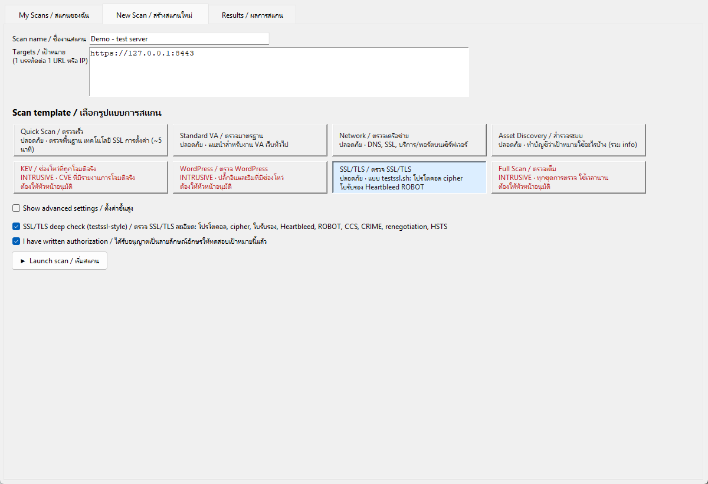
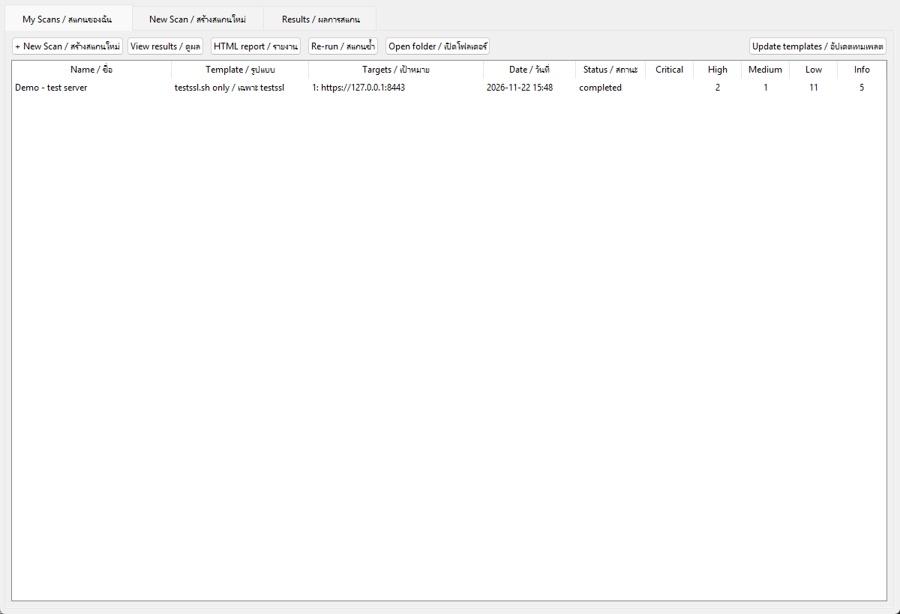
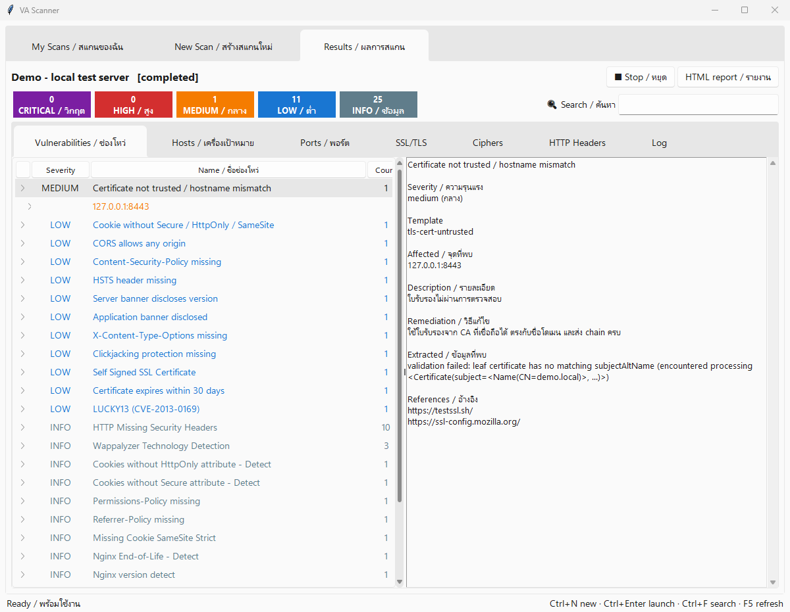
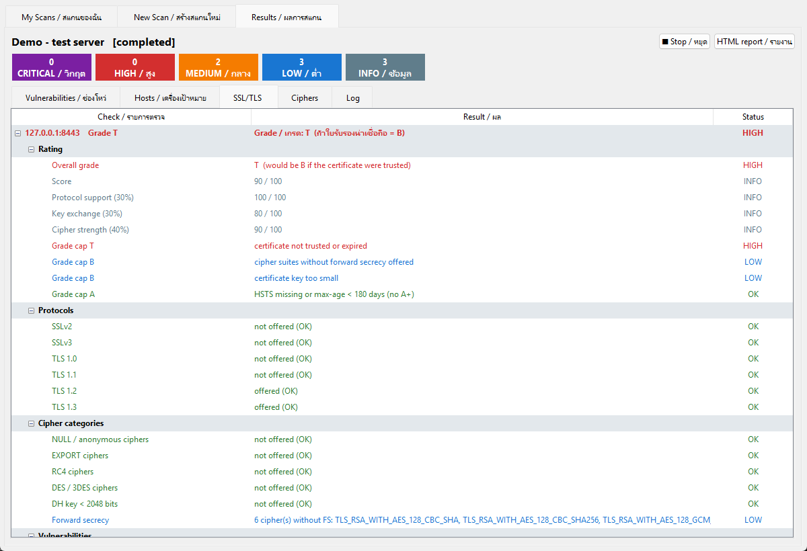
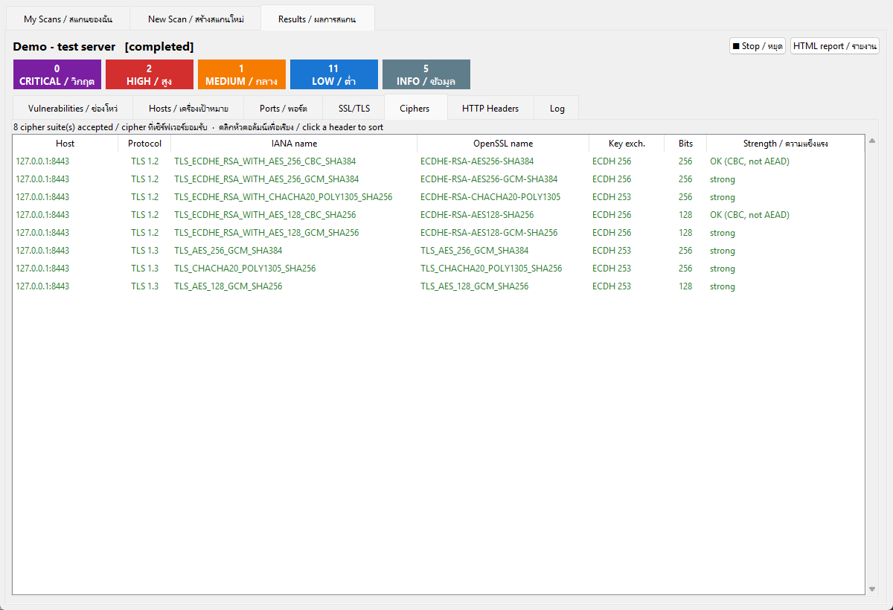
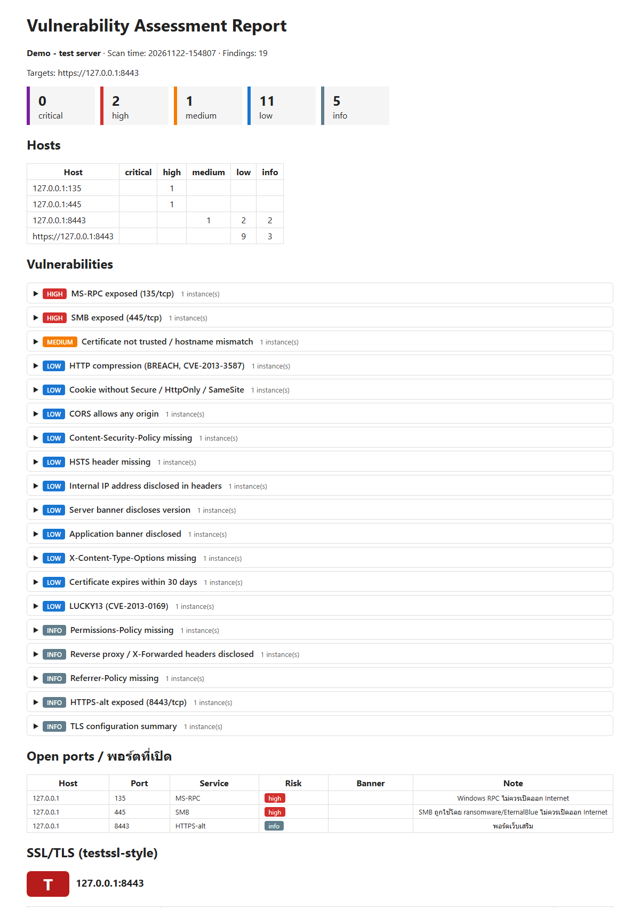

# VA Scanner

โปรแกรมสแกนช่องโหว่ (Vulnerability Assessment) แบบมีหน้าจอ สำหรับทีม VA ใช้ [nuclei](https://github.com/projectdiscovery/nuclei) เป็นตัวสแกน ตรวจ SSL/TLS และ HTTP header แบบ [testssl.sh](https://testssl.sh/) ผ่าน [sslyze](https://github.com/nabla-c0d3/sslyze) และสแกนพอร์ตได้ในตัว ไม่ต้องลง Python ไม่ต้องใช้ command line

> ⚠️ **ใช้กับระบบที่ได้รับอนุญาตเป็นลายลักษณ์อักษรเท่านั้น** การสแกนระบบของผู้อื่นโดยไม่ได้รับอนุญาตผิดกฎหมาย (พ.ร.บ.คอมพิวเตอร์ฯ)



## สารบัญ

- [ดาวน์โหลดและติดตั้ง](#ดาวน์โหลดและติดตั้ง)
- [เริ่มสแกน](#เริ่มสแกน)
- [รูปแบบการสแกน](#รูปแบบการสแกน)
- [โมดูล](#โมดูล)
- [ดูผลการสแกน](#ดูผลการสแกน)
- [สแกนพอร์ต](#สแกนพอร์ต)
- [ตรวจ SSL/TLS และเกรด](#ตรวจ-ssltls-และเกรด)
- [ตรวจ HTTP header](#ตรวจ-http-header)
- [รายงาน HTML](#รายงาน-html)
- [กฎของทีม](#กฎของทีม)
- [ปัญหาที่พบบ่อย](#ปัญหาที่พบบ่อย)
- [สำหรับนักพัฒนา](#สำหรับนักพัฒนา)

## ดาวน์โหลดและติดตั้ง

1. ไปที่หน้า [**Releases**](https://github.com/tongkhemmathat-dot/nuclei/releases) แล้วดาวน์โหลด `VA-Scanner-vX.Y.Z-win64.zip` ของเวอร์ชันล่าสุด
2. แตกไฟล์ไปไว้ที่ไหนก็ได้ เช่น `D:\VA-Scanner`
3. ดับเบิลคลิก `VA-Scanner.exe`

ต้องใช้ Windows 10/11 แบบ 64 บิต ในชุดดาวน์โหลดมี nuclei.exe, ชุดการตรวจ (templates) และรายชื่อ CA สำหรับตรวจใบรับรองมาให้ครบแล้ว จึงสแกนได้แม้ไม่มีอินเทอร์เน็ต

| ไฟล์ในโฟลเดอร์ | หน้าที่ |
|---|---|
| `VA-Scanner.exe` | ตัวโปรแกรม |
| `nuclei.exe` | เครื่องมือสแกน (ห้ามลบ) |
| `nuclei-templates\` | ชุดการตรวจ ถ้าลบ โปรแกรมจะดาวน์โหลดใหม่ตอนเปิด |
| `pem_files\` | รายชื่อ CA ที่เชื่อถือได้ สำหรับตรวจใบรับรอง (ห้ามลบ) |
| `reports\` | ผลสแกน สร้างขึ้นเองหลังสแกนครั้งแรก |

## เริ่มสแกน

ไปที่แท็บ **New Scan / สร้างสแกนใหม่**

1. **ชื่องานสแกน:** เช่น `ลูกค้า A - เว็บหลัก`
2. **เป้าหมาย:** 1 บรรทัดต่อ 1 รายการ เช่น `https://www.example.com` หรือ `10.0.0.5:8443`
3. **รูปแบบการสแกน:** คลิกการ์ดที่ต้องการ ถ้าไม่แน่ใจให้ใช้ **Standard VA**
4. **ยืนยันการอนุญาต:** ติ๊ก "ได้รับอนุญาตเป็นลายลักษณ์อักษร" ถ้าไม่ติ๊กจะสแกนไม่ได้
5. กด **▶ เริ่มสแกน**

ระหว่างสแกน โปรแกรมจะพาไปหน้า Results และผลจะอัปเดตทุก 3 วินาที เมื่อสแกนเสร็จ รายงาน HTML จะสร้างให้เอง

ถ้าต้องการปรับชุดการตรวจ, severity, แท็ก หรือความเร็ว ให้ติ๊ก **ตั้งค่าขั้นสูง** ส่วนนี้สำหรับผู้มีประสบการณ์

## รูปแบบการสแกน

| การ์ด | ประเภท | ใช้เมื่อ |
|---|---|---|
| Quick Scan / ตรวจเร็ว | ปลอดภัย | ดูภาพรวมเร็วๆ (~5 นาที) |
| **Standard VA / ตรวจมาตรฐาน** | ปลอดภัย | **งาน VA เว็บทั่วไป (แนะนำ)** |
| Network / ตรวจเครือข่าย | ปลอดภัย | สแกนพอร์ต, DNS, SSL, บริการบนเซิร์ฟเวอร์ |
| Asset Discovery / สำรวจระบบ | ปลอดภัย | ทำบัญชีว่าเป้าหมายใช้เทคโนโลยีและเปิดพอร์ตอะไร |
| Port Scan / สแกนพอร์ต | ปลอดภัย | สแกนพอร์ตอย่างเดียว (ไม่รัน nuclei) |
| testssl.sh only / เฉพาะ testssl | ปลอดภัย | ตรวจ SSL/TLS + HTTP header อย่างเดียวแบบ testssl.sh (ไม่รัน nuclei) |
| SSL/TLS / ตรวจ SSL/TLS | ปลอดภัย | ตรวจ TLS แบบ testssl.sh พร้อมเกรด + nuclei ชุด ssl |
| HTTP Headers / ตรวจ Header | ปลอดภัย | ตรวจ HTTP header อย่างเดียว (ไม่รัน nuclei) |
| KEV / ช่องโหว่ที่ถูกโจมตีจริง | 🔴 INTRUSIVE | CVE ที่มีรายงานว่าถูกใช้โจมตีจริง |
| WordPress / ตรวจ WordPress | 🔴 INTRUSIVE | เว็บที่ใช้ WordPress |
| Full Scan / ตรวจเต็ม | 🔴 INTRUSIVE | ตรวจทุกชุด ใช้เวลานาน |

การ์ดสีแดง (**INTRUSIVE**) ส่ง payload ทดสอบช่องโหว่จริง อาจทำให้ระบบล่มหรือบัญชีถูกล็อก **ต้องให้หัวหน้าอนุมัติก่อน** โปรแกรมจะถามยืนยันอีกครั้งก่อนเริ่ม

## โมดูล

การสแกนแบ่งเป็น 4 โมดูล รันแยกกันได้อิสระ การ์ดรูปแบบการสแกนจะติ๊กให้อัตโนมัติ และแก้ได้ในกรอบ **Modules / โมดูล** ก่อนกดเริ่ม

| โมดูล | ทำอะไร | ผลอยู่ที่แท็บ |
|---|---|---|
| Nuclei templates | รัน nuclei ตามชุดการตรวจของการ์ด ถ้าไม่ติ๊กจะข้าม nuclei | Vulnerabilities |
| Port scan / สแกนพอร์ต | TCP connect + อ่าน banner และให้ระดับความเสี่ยงตามบริการ | Ports / พอร์ต |
| SSL/TLS (testssl-style) | โปรโตคอล, cipher, ใบรับรอง, ช่องโหว่ TLS และเกรด | SSL/TLS, Ciphers |
| HTTP headers / ตรวจ header | security header, banner, X-Forwarded, cookie, CORS, BREACH | HTTP Headers |

ปัญหาที่พบจากทุกโมดูลจะรวมอยู่ในแท็บ Vulnerabilities, Hosts และรายงาน HTML ด้วย ส่วนการกรอง severity ในตั้งค่าขั้นสูงใช้กับทุกโมดูล

## ดูผลการสแกน

**My Scans / สแกนของฉัน** แสดงงานสแกนทั้งหมด จำนวนช่องโหว่แต่ละระดับ และสถานะ ดับเบิลคลิกเพื่อดูผล ปุ่ม **สแกนซ้ำ** จะใส่ค่าเดิมกลับมาให้ แต่ต้องติ๊กยืนยันการอนุญาตใหม่ทุกครั้ง



**Results / ผลการสแกน** มีแท็บย่อย:

| แท็บ | แสดงอะไร |
|---|---|
| Vulnerabilities / ช่องโหว่ | ช่องโหว่จัดกลุ่มตามชื่อ เรียงจากรุนแรงสุด กด ⊞ เพื่อดูว่าพบที่ URL ไหน ด้านขวาเป็นรายละเอียด วิธีแก้ ลิงก์อ้างอิง และคำสั่ง curl สำหรับทดสอบซ้ำ |
| Hosts / เครื่องเป้าหมาย | จำนวนช่องโหว่ของแต่ละเครื่อง ดับเบิลคลิกเพื่อดูเฉพาะเครื่องนั้น |
| Ports / พอร์ต | พอร์ตที่เปิด, บริการ, banner และระดับความเสี่ยง เรียงจากเสี่ยงสุด |
| SSL/TLS | ตารางผลตรวจ TLS แบบ testssl.sh พร้อมเกรด |
| Ciphers | รายการ cipher ทุกตัวที่เซิร์ฟเวอร์รับ |
| HTTP Headers | ตารางผลตรวจ header แบบ `testssl.sh -h` |
| Log | ข้อความจาก nuclei และทุกโมดูล สำหรับตรวจสอบเวลามีปัญหา |



## สแกนพอร์ต

ติ๊ก **Port scan** แล้วใส่รายการพอร์ตในช่องข้างๆ:

| ใส่ | สแกน |
|---|---|
| `top` (ค่าเริ่มต้น) | พอร์ตสำคัญ 66 พอร์ต เช่น FTP, SSH, SMTP, RDP, SMB, RPC, ฐานข้อมูล, Redis, Docker API, หน้าแอดมิน |
| `all` | ทุกพอร์ต 1–65535 (อาจใช้เวลาหลายสิบนาทีต่อ host ถ้ามี firewall) |
| `1-1024,3389` | ช่วงหรือรายการที่กำหนดเอง ผสมกับ `top` ได้ เช่น `top,8081` |

ระดับความเสี่ยงคิดจากการเปิดออก Internet เช่น RDP, SMB, RPC, ฐานข้อมูล = high, Docker API = critical, FTP, WinRM = medium, เว็บ = info

> สแกนแบบ TCP connect รอบเดียว 100 thread timeout 2 วินาที ไม่สแกน UDP ถ้าเป้าหมายมี IPS ที่ตัด connection เวลาสแกนถี่ บางพอร์ตอาจหลุด ให้สแกนซ้ำเพื่อยืนยัน

## ตรวจ SSL/TLS และเกรด

ติ๊กโมดูล **SSL/TLS** (การ์ดที่มีชุด ssl จะติ๊กให้อัตโนมัติ) ตรวจได้เฉพาะเป้าหมาย `https://` หรือ `host:port` และใช้เวลาประมาณ 30–60 วินาทีต่อ host

| หมวด | รายการที่ตรวจ |
|---|---|
| Protocols | SSLv2, SSLv3, TLS 1.0, 1.1, 1.2, 1.3 |
| Cipher categories | NULL/anon, EXPORT, RC4, DES/3DES, DH < 2048, Forward secrecy |
| Vulnerabilities | Heartbleed, CCS injection, ROBOT, CRIME, renegotiation, FALLBACK_SCSV, DROWN, POODLE, SWEET32, FREAK, LOGJAM, RC4, BEAST, LUCKY13, 0-RTT |
| Certificate | Subject, SAN, Issuer, คีย์, ลายเซ็น, วันหมดอายุ, ความน่าเชื่อถือใน trust store 5 ค่าย (Mozilla/Apple/Windows/Android/Java), chain, OCSP, CT, EV |
| HTTP headers | HSTS (ถ้าเปิดโมดูล HTTP headers ด้วย จะรายงาน HSTS ที่โมดูลนั้นแทน) |



**เกรด** คิดตาม [SSL Labs Server Rating Guide](https://github.com/ssllabs/research/wiki/SSL-Server-Rating-Guide) วิธีเดียวกับ `testssl.sh --rating`

- **คะแนน 0–100:** โปรโตคอล 30% + key exchange 30% + ความแข็งแรงของ cipher 40% แล้วแปลงเป็น A (≥80), B (≥65), C (≥50), D (≥35), E (≥20), F
- **ตัวจำกัดเกรด:** ถ้าพบจุดอ่อน เกรดจะไม่เกินระดับที่กำหนด

| ไม่เกิน | เมื่อพบ |
|---|---|
| F | SSLv2, Heartbleed, CCS, ROBOT, insecure renegotiation, EXPORT/NULL/anon cipher, DH < 1024 |
| C | SSLv3, CRIME, 3DES/DES, ไม่รองรับ TLS 1.2 |
| B | RC4, TLS 1.0/1.1, cipher ไม่มี forward secrecy, ไม่มี AEAD, DH < 2048, คีย์ใบรับรองสั้น, SHA-1, ไม่มี FALLBACK_SCSV |
| A | ไม่มี TLS 1.3 หรือ HSTS สั้นกว่า 180 วัน (ไม่ได้ A+) |

- **A+:** ได้ A โดยไม่ติดตัวจำกัดใดเลย
- **T:** ใบรับรองไม่น่าเชื่อถือหรือหมดอายุ โปรแกรมจะบอกด้วยว่าถ้าใบรับรองน่าเชื่อถือจะได้เกรดอะไร

> เกรดนี้คำนวณตามหลักเกณฑ์ข้างต้น อาจต่างจาก SSL Labs หรือ testssl.sh ตัวจริงเล็กน้อย เช่น ยังไม่มีเกรด A-

แท็บ **Ciphers** แสดง cipher ทุกตัวที่เซิร์ฟเวอร์รับ แบบ `testssl -E` ได้แก่ โปรโตคอล, ชื่อ IANA, ชื่อ OpenSSL, key exchange, จำนวนบิต และความแข็งแรง คลิกหัวคอลัมน์เพื่อเรียง

| ความแข็งแรง | ความหมาย |
|---|---|
| strong | AEAD + forward secrecy |
| OK (CBC, not AEAD) | ใช้ได้ แต่ควรเปลี่ยนเป็น GCM/CHACHA20 |
| weak (no forward secrecy) | RSA key exchange ถ้า private key รั่ว จะถอดรหัสทราฟฟิกย้อนหลังได้ |
| weak (64-bit block, SWEET32) | 3DES |
| insecure | NULL, anon, EXPORT, RC4, DES |



## ตรวจ HTTP header

ติ๊กโมดูล **HTTP headers** โปรแกรมจะส่ง GET 1 ครั้งต่อเป้าหมาย ไม่ตาม redirect (แบบเดียวกับ testssl.sh) แล้วตรวจ:

| หมวด | รายการที่ตรวจ |
|---|---|
| Security headers | Strict-Transport-Security, Content-Security-Policy, X-Frame-Options / frame-ancestors, X-Content-Type-Options, Referrer-Policy, Permissions-Policy, X-XSS-Protection |
| Banners | Server ที่บอกเวอร์ชัน, X-Powered-By, X-AspNet-Version, X-AspNetMvc-Version, X-Generator, X-Runtime |
| Reverse proxy / X-Forwarded | Via, X-Forwarded-For/Host/Proto/Server, X-Real-IP, X-Cache, X-Varnish, X-Served-By, X-Backend-Server, IP ภายในที่หลุดใน header, X-Forwarded-Host injection |
| Cookies | Secure, HttpOnly, SameSite ของทุก cookie |
| Other | CORS `Access-Control-Allow-Origin: *`, BREACH (HTTP compression) |

การทดสอบ X-Forwarded-Host injection จะส่ง header `X-Forwarded-Host: va-scanner-probe.invalid` ไปด้วย ถ้าค่านี้สะท้อนกลับมาใน header หรือหน้าเว็บ แปลว่าเสี่ยง cache poisoning / password-reset poisoning ไม่มีการส่ง payload อื่น

## รายงาน HTML

ทุกสแกนจะสร้าง `reports\<วันเวลา>\report.html` ให้เอง เปิดได้จากปุ่ม **HTML report / รายงาน** ในหน้า My Scans หรือ Results

ในรายงานมีสรุปจำนวนตาม severity, ตารางรายเครื่อง, รายละเอียดช่องโหว่พร้อมวิธีแก้ ตารางพอร์ตที่เปิด, ตาราง SSL/TLS พร้อมเกรดและรายการ cipher และตาราง HTTP header ถ้าต้องการไฟล์ PDF สำหรับส่งลูกค้า ให้กด `Ctrl+P` แล้วเลือก "Save as PDF"



ไฟล์อื่นในโฟลเดอร์ผลสแกน:

| ไฟล์ | เนื้อหา |
|---|---|
| `findings.jsonl` | ผลทั้งหมดแบบ JSON บรรทัดละรายการ สำหรับนำไปใช้ต่อ |
| `findings.txt` | ผลจาก nuclei แบบข้อความ |
| `markdown\` | รายงานแยกรายการแบบ Markdown |
| `ports.json` | พอร์ตที่เปิด, banner และระดับความเสี่ยง |
| `tls.json` | ผลตรวจ TLS, เกรด และรายการ cipher |
| `headers.json` | ผลตรวจ HTTP header |
| `scan.json` / `scan.log` | ค่าที่ใช้สแกนและ log |

## กฎของทีม

1. **ห้ามสแกนเป้าหมายที่ไม่มีหนังสืออนุญาต** และต้องตรวจขอบเขต (scope) ให้ตรงกับหนังสือ
2. การ์ด **INTRUSIVE** ต้องให้หัวหน้าอนุมัติก่อนทุกครั้ง
3. ความเร็วไม่ควรเกิน **20 ครั้ง/วินาที** กับระบบ production ของลูกค้า (ค่าเริ่มต้นตั้งไว้ 20)
4. กด **อัปเดตเทมเพลต** สัปดาห์ละครั้ง (ต้องใช้อินเทอร์เน็ต)
5. โฟลเดอร์ `reports\` เป็นข้อมูลลูกค้า **ห้ามอัปโหลดขึ้น GitHub หรือแชร์ภายนอก**

## ปัญหาที่พบบ่อย

| อาการ | วิธีแก้ |
|---|---|
| Windows ขึ้น "Windows protected your PC" | กด **More info** แล้วกด **Run anyway** (โปรแกรมยังไม่ได้ sign) |
| แอนตี้ไวรัสลบหรือบล็อก `nuclei.exe` | เป็นเครื่องมือสแกนช่องโหว่ จึงถูกตรวจจับบ่อย ขอฝ่าย IT ให้ whitelist โฟลเดอร์ VA-Scanner |
| ขึ้น "ไม่พบ nuclei.exe" | ต้องวาง `nuclei.exe` ไว้โฟลเดอร์เดียวกับ `VA-Scanner.exe` |
| แท็บ Ports บอก "ไม่ได้เลือกโมดูลสแกนพอร์ต" | ติ๊ก Port scan ในกรอบโมดูล หรือใช้การ์ด Port Scan / Network |
| ตาราง SSL/TLS ว่าง | เป้าหมายเป็น `http://` แบบไม่ระบุพอร์ต (จะถูกข้าม) หรือเชื่อมต่อ TLS ไม่ได้ ดูสาเหตุในแท็บ Log |
| "Certificate check failed" ในผล TLS | โฟลเดอร์ `pem_files\` หายไป ให้แตกไฟล์ zip ใหม่ |
| สแกนนานมาก | ใช้ Quick Scan หรือลดจำนวนเป้าหมาย Full Scan อาจใช้เวลาหลายชั่วโมง |
| ปุ่ม Stop ไม่หยุดทันที | สแกนพอร์ตจะหยุดภายในไม่กี่วินาที แต่ช่วงตรวจ TLS หยุดกลางทางไม่ได้ รอประมาณ 30–60 วินาทีต่อ host โมดูลที่เหลือจะถูกข้าม |

## สำหรับนักพัฒนา

ซอร์สทั้งหมดอยู่ในไฟล์เดียว: [`nuclei_gui.py`](nuclei_gui.py) (Python 3 + Tkinter)

```bat
pip install pyinstaller sslyze
python nuclei_gui.py --test                          :: self-check
python nuclei_gui.py                                 :: รัน GUI (วาง nuclei.exe ไว้โฟลเดอร์เดียวกัน)
"Nuclei Scanner.bat"                                 :: เปิด GUI แบบไม่มีหน้าต่าง console (ต้องมี Python)
python nuclei_gui.py --tls https://host out.json     :: ตรวจ TLS อย่างเดียว ได้ผลเป็น JSON
build.bat                                            :: build dist\VA-Scanner\VA-Scanner.exe
```

ทำ release:
1. รัน `build.bat`
2. ใส่ [`nuclei.exe`](https://github.com/projectdiscovery/nuclei/releases) ไว้ใน `dist\VA-Scanner\`
3. เปิดโปรแกรมครั้งหนึ่งเพื่อดาวน์โหลด templates
4. zip โฟลเดอร์นั้นโดย**ไม่รวม `reports\`** แล้วแนบใน GitHub Release

## License

VA Scanner ใช้สัญญาอนุญาต [AGPL-3.0](LICENSE) เพราะ `VA-Scanner.exe` รวม sslyze และ nassl ซึ่งเป็น AGPL-3.0 ไว้ด้วย

| ส่วนประกอบ | เจ้าของ | License |
|---|---|---|
| [nuclei](https://github.com/projectdiscovery/nuclei), [nuclei-templates](https://github.com/projectdiscovery/nuclei-templates) | ProjectDiscovery | MIT |
| [sslyze](https://github.com/nabla-c0d3/sslyze), [nassl](https://github.com/nabla-c0d3/nassl) | Alban Diquet | AGPL-3.0 |

ในชุดดาวน์โหลดมีไฟล์ license ของทุกส่วนอยู่ในโฟลเดอร์ `LICENSES\`
